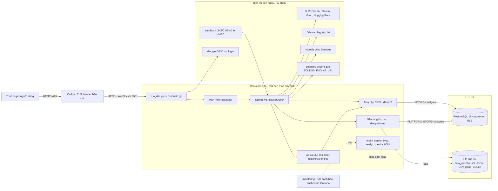

# EduDSS — Kiến trúc hệ thống

> **Trạng thái: BẢN NHÁP — chờ chủ dự án duyệt** (soạn 21/11/2026, dựa trên commit 6e9710d)

Tài liệu này mô tả EduDSS **đang được xây như thế nào** trong code hiện tại. Không có thành phần nào được
bịa thêm. Mỗi ý đều ghi nguồn (đường dẫn trong repo, có số dòng khi cần). Lý do nào do người soạn tự suy ra
từ code thì ghi **(suy luận — cần xác nhận)**.

Tài liệu liên quan: [../requirements/PRD.md](../requirements/PRD.md) ·
[../database/SCHEMA.md](../database/SCHEMA.md) · [../ux/SCREEN_MAP.md](../ux/SCREEN_MAP.md) ·
[../operations/RELEASE_PROCESS.md](../operations/RELEASE_PROCESS.md) ·
[../operations/BACKUP_RECOVERY_RUNBOOK.md](../operations/BACKUP_RECOVERY_RUNBOOK.md)

---

## 1. Tóm tắt bằng lời thường

- EduDSS là **một ứng dụng web Streamlit duy nhất**. Không có backend API riêng, không có frontend riêng.
  Mọi màn hình, xử lý nghiệp vụ và học máy chạy chung trong một tiến trình Python
  (`Dockerfile:138`, `run_dss.py:1-5`).
- Cùng container còn chạy một tiến trình nhỏ trả lời kiểm tra sức khoẻ (`/livez`, `/readyz`) và số đo
  `/metrics` ở cổng 8081 (`dss/core/health_server.py:3-16`, `Dockerfile:138`).
- Dữ liệu có **hai chế độ lưu**: máy dev lưu ra file (JSON/CSV/joblib/SQLite) trong `data_warehouse/`.
  Bản production lưu vào **PostgreSQL 16 + pgvector**, bật **riêng cho từng tính năng** bằng biến
  `EDUDSS_<TÍNH_NĂNG>_STORE=postgres` (`dss/core/persistence_config.py:55-117`).
- Đi ra ngoài Internet: Caddy lo HTTPS. Bên trong có thể gọi AI ngoài (OpenAI, Gemini, Groq) hoặc AI chạy
  tại chỗ (Ollama), và kết nối LMS (Moodle, webhook LMS/CMS).

## 2. Sơ đồ tổng thể

Nguồn sơ đồ: luồng Internet → Caddy → app → postgres lấy từ `deploy/production/docker-compose.prod.yml:3-12`.
Đường kết nối giữa các thư mục `dss/*` lấy từ các lệnh `import` trong `dss/main.py:61-68` và các file nêu ở mục 3.

## 3. Các thành phần

| Thành phần | Công nghệ | Code | Vai trò |
|---|---|---|---|
| Điểm vào | Streamlit `1.54.0` (`requirements.txt:20`) | `run_dss.py`, `dss/main.py` (908 dòng) | Nạp `dss/main.py`, gắn mã theo dõi cho mỗi lượt chạy lại (`run_dss.py:17-30`), dựng điều hướng theo vai trò |
| Màn hình (UI) | Streamlit | `dss/tabs/` (21 file, ví dụ `dashboard.py`, `ai_advisor.py`, `classroom_tab.py`) | Từng tab giao diện; được `dss/main.py:61-68` import |
| Nghiệp vụ | Python | `dss/services/` (ví dụ `auth_service.py`, `rag_service.py`, `model_registry.py`, `llm_gateway.py`) | Đăng nhập, phân quyền, RAG, kho mô hình, gọi LLM, kế hoạch học tập |
| Lõi và học máy | scikit-learn `1.8.0`, LightGBM `4.6.0`, SHAP `0.51.0` (`requirements.txt:32-58`) | `dss/core/`, gói huấn luyện `dss/core/training/` | Kho dữ liệu file (`warehouse.py`), huấn luyện, chọn chế độ lưu (`persistence_config.py`), sức khoẻ, số đo |
| Truy cập CSDL | SQLAlchemy 2, Alembic, psycopg2, pgvector (`requirements.txt:122-130`) | `dss/db/session.py`, `dss/db/models.py`, `dss/db/repositories/`, `dss/db/migrations/versions/` | 41 bảng lõi, 10 migration. Chi tiết: [SCHEMA.md](../database/SCHEMA.md) |
| Nền tảng lớp học | SQLAlchemy (bộ model riêng `PlatformBase`) | `dss/platform/models.py`, `dss/platform/store.py` | 13 bảng `lp_*`: trường, lớp, bài đánh giá, chương trình. Dev dùng SQLite `learning_platform.sqlite3` (`dss/platform/store.py:38-44`) |
| Bảo mật | Python chuẩn | `dss/security/` (`pseudonymization.py`, `login_throttle.py`, `log_redaction.py`, `upload_security.py`, `prompt_boundary.py`) | Bút danh hoá, chặn đăng nhập dò mật khẩu, che dữ liệu nhạy cảm trong log |
| Mật khẩu | PBKDF2-HMAC-SHA256, 600.000 vòng | `dss/services/auth_service.py:48-84` | Băm mật khẩu tài khoản nội bộ |
| Đăng nhập Google | OIDC native của Streamlit (`st.login`) + Authlib (`requirements.txt:96`) | `dss/services/google_signin.py:1,83`, `ops/write_streamlit_secrets.py:1-6` | Đăng nhập bằng Google; cấu hình `[auth]` ghi vào `.streamlit/secrets.toml` khi container khởi động |
| Gọi LLM | `openai 2.14.0`, `google-genai 2.19.0`, `groq 1.0.0` (`requirements.txt:91-93`) | `dss/services/llm_gateway.py:246-442` | Chọn nhà cung cấp (`gemini`, `groq`, `openai`, `huggingface`, `ollama`), có chuỗi dự phòng (`llm_gateway.py:500-607`) |
| Embedding | `sentence-transformers 5.6.0` (`requirements.txt:85`), mô hình `all-MiniLM-L6-v2`, 384 chiều | `dss/core/models.py:792`, `dss/db/models.py:43` | Biến văn bản thành vector cho RAG, chạy tại chỗ |
| Kho vector | `LocalVectorStore` (file) / `PgVectorStore` (pgvector) | `dss/services/vector_store.py:82,309,669-684` | Chọn Postgres khi `EDUDSS_RAG_STORE=postgres`, ngược lại dùng file |
| Kết nối LMS | REST Moodle; webhook có chữ ký HMAC-SHA256 | `dss/services/moodle_connector.py:1-12`, `dss/integrations/lms_cms_connector.py:252-253`, `dss/services/lms_live_sync.py:53` | Lấy điểm, danh sách lớp từ Moodle; nhận sự kiện LMS/CMS, khoá ký đọc từ `EDUDSS_LMS_WEBHOOK_SECRET` |
| Learning engine (tuỳ chọn) | HTTP, có khoá ký | `dss/services/engine_gateway.py:41-45` | Chỉ bật khi đặt `EDUDSS_ENGINE_URL` |
| Sức khoẻ và số đo | `http.server`, `prometheus-client 0.26.0` (`requirements.txt:99`) | `dss/core/health_server.py`, `dss/core/metrics_exporter.py` | `/livez`, `/readyz` (kiểm CSDL, schema head, khoá bút danh), `/metrics` có Bearer token |
| Giám sát | Cấu hình Prometheus/Grafana | `monitoring/alerts/edudss-rules.yml`, `monitoring/grafana/edudss-production.json` | Luật cảnh báo và dashboard. Không file compose nào trong repo khởi chạy Prometheus hay Grafana, nên phải có hệ thống giám sát bên ngoài (suy luận — cần xác nhận) |
| HTTPS | Caddy 2 | `deploy/production/Caddyfile`, `deploy/standalone/Caddyfile:1-15` | Tự xin chứng chỉ Let's Encrypt/ZeroSSL, thêm header bảo mật, chuyển tiếp WebSocket |
| Công việc định kỳ | Python | `ops/pipeline` (chạy qua service `worker`, `deploy/standalone/docker-compose.yml:54-58`) | KPI theo giờ, kiểm chất lượng dữ liệu, sao lưu và diễn tập khôi phục (`deploy/cloud/docker-compose.yml:5`) |
| Công cụ vận hành | Python | `ops/migration_check.py`, `ops/backup_recovery.py`, `ops/bootstrap_identity.py` | Kiểm tra migration, sao lưu/khôi phục, tạo tài khoản quản trị đầu tiên |

**Không tìm thấy** module gửi email/SMTP nào trong `dss/` (tìm `smtp|sendmail|email.mime`, không có kết quả).

## 4. Lý do chọn công nghệ

| Lựa chọn | Lý do | Nguồn |
|---|---|---|
| Streamlit, một tiến trình | Dựng giao diện dữ liệu và ML nhanh bằng Python thuần, không cần đội frontend riêng. Đồ án có quy mô nhỏ | (suy luận — cần xác nhận) |
| Gộp về một codebase `dss/` | Bản monolith cũ `app/5.py` bị xoá vì hai codebase song song buộc mỗi thay đổi phải sửa hai lần | `docker-compose.yml:89-92` |
| PostgreSQL + Row Level Security | Chỉ lọc `organization_id` trong code thì một lần quên lọc là lộ dữ liệu trường khác. RLS biến việc cô lập trường thành bảo đảm của CSDL | `dss/db/migrations/versions/cbae9b411ed5_row_level_security_tenant_isolation.py:7-15` |
| App kết nối bằng role không phải superuser | Superuser và chủ bảng bỏ qua RLS. Production tách role chủ (chạy migration) và role app | `cbae9b411ed5_…py:17-23`, `deploy/production/docker-compose.prod.yml:47-54,68` |
| pgvector trong cùng PostgreSQL | Không cần thêm một CSDL vector riêng; sao lưu chung một chỗ | (suy luận — cần xác nhận); runbook sao lưu có cột pgvector ở `docs/operations/BACKUP_RECOVERY_RUNBOOK.md:3-4` |
| Chuyển sang Postgres từng tính năng một | Đổi toàn bộ chỗ lưu (nhất là đăng nhập) một lần là thay đổi lớn và rủi ro; phải tương thích ngược trước | `dss/db/models.py:3-11`, `dss/core/persistence_config.py:1-21` |
| Bảng ánh xạ 1:1 với file JSON cũ | Để việc chuyển dữ liệu chỉ là sao chép, không phải thiết kế lại | `dss/db/models.py:9-11` |
| Có `organization_id` ngay từ đầu | Thêm cột trường vào schema đã chạy về sau rủi ro hơn nhiều | `dss/db/models.py:13-15` |
| PBKDF2 qua `hashlib` | Thư viện chuẩn, không cần thêm dependency; 600.000 vòng theo khuyến nghị OWASP | `dss/services/auth_service.py:8-9,48-51` |
| Google qua `st.login` | Dùng OIDC có sẵn của Streamlit thay vì tự viết luồng OAuth | `dss/services/google_signin.py:1`, `ops/write_streamlit_secrets.py:3` |
| Embedding `all-MiniLM-L6-v2` chạy tại chỗ | Nhẹ, mặc định cho RAG; không gửi văn bản ra ngoài để tạo vector | `dss/core/models.py:411,792`; ý "không gửi ra ngoài" là (suy luận — cần xác nhận) |
| Nhiều nhà cung cấp LLM, có Ollama | Có chuỗi dự phòng; có thể chạy "không AI bên ngoài" khi để trống khoá API | `dss/services/llm_gateway.py:500-607`, `deploy/production/docker-compose.prod.yml:87-91` |
| Caddy | HTTPS tự động, tự gia hạn chứng chỉ | `deploy/standalone/Caddyfile:3-6` |
| Mặc định coi là production khi thiếu `EDUDSS_ENV` | Chạy an toàn khi quên cấu hình (fail closed) | `dss/core/runtime_mode.py:6-10,49-54` |

## 5. Hai chế độ lưu dữ liệu

### 5.1 Dev và production khác nhau thế nào

| | Dev (máy cá nhân, demo) | Production (một trường thật) |
|---|---|---|
| Bật bằng | `EDUDSS_ENV=development` (`dss/core/runtime_mode.py:10`) | `EDUDSS_ENV=production` (`deploy/production/docker-compose.prod.yml:65`) |
| Nơi lưu chính | File trong `data_warehouse/` (gốc dữ liệu lấy từ `dss/core/data_root.py`) | PostgreSQL 16 + pgvector (`docker-compose.prod.yml:27-28`) cho các tính năng đã bật; phần còn lại vẫn là file trong volume `appdata:/app/data_warehouse` (`docker-compose.prod.yml:93-94`) |
| Tài khoản | `users.json` | Bảng `users` (`EDUDSS_IDENTITY_STORE=postgres`, `dss/services/auth_service.py`, `dss/core/persistence_config.py:80-91`) |
| Mô hình ML | File joblib/JSON | **Vẫn là file joblib/JSON.** Postgres chỉ giữ bản sao metadata khi bật `ML_PROVENANCE` (`dss/core/persistence_config.py:67-76`) |
| Lớp học `lp_*` | SQLite `learning_platform.sqlite3` (`dss/platform/store.py:38-44`) | Postgres; production **bắt buộc** (`dss/platform/store.py:29-30`) |
| Migration | Không cần (file) | `python -m alembic upgrade head` qua service `migrate` (`docker-compose.prod.yml:47-59`) |

### 5.2 Công tắc từng tính năng

Mỗi công tắc là biến `EDUDSS_<TÊN>_STORE`, chỉ nhận `local` (mặc định) hoặc `postgres`. Giá trị khác thì báo lỗi.
Tên chưa có repository Postgres thì từ chối chạy, không âm thầm quay về file
(`dss/core/persistence_config.py:44-46,98-117`).

| Tính năng (`<TÊN>`) | Nơi đọc công tắc | Bảng Postgres | Prod compose đặt `postgres`? (`docker-compose.prod.yml:70-74`) |
|---|---|---|---|
| `IDENTITY` | `dss/services/auth_service.py` qua `repository_for` (`persistence_config.py:80-91`) | `users` | ✅ dòng 70 |
| `LEARNING_PLANS` | `dss/services/learning_plan_history.py:43,164` (production bắt buộc, dòng 43-44) | `recommendations` | ✅ dòng 71 |
| `PLATFORM` | `dss/platform/store.py:26-30` (production bắt buộc) | 13 bảng `lp_*` | ✅ dòng 72 |
| `CMS` | `dss/services/cms_lecture_repository.py:127` | `cms_*` | ✅ dòng 73 |
| `RAG` | `dss/services/vector_store.py:676` | `rag_documents`, `rag_chunks` | ✅ dòng 74 |
| `PREDICTIONS` | `dss/core/warehouse.py:345` | `predictions` | ❌ không có |
| `CONSULTATIONS` | `dss/core/warehouse.py:391` | `consultations` | ❌ không có |
| `ACTIVITY` | `dss/core/warehouse.py:721` | `activity_logs` | ❌ không có |
| `SUBSCRIPTION` | `dss/services/subscription_service.py:68` | `subscriptions` | ❌ không có |
| `ACADEMIC` | `dss/services/academic_persistence.py:20` | `students`, `courses`, `grades`… | ❌ không có |
| `ADMIN_AI_CONFIG` | `dss/services/admin_ai_config.py:38` | `admin_ai_config` | ❌ không có |
| `AI_TOKEN_USAGE` | `dss/services/token_tracker.py:153` | `ai_token_usage` | ❌ không có |
| `ML_PROVENANCE` | `dss/services/ml_provenance.py:691`, `dss/services/model_registry.py:165` | `dataset_provenance`, `feature_schema_provenance`, `drift_evaluations` | ❌ không có |

> ⚠️ **Cần xác nhận: 8 tính năng vẫn lưu file trong production**
>
> `deploy/production/docker-compose.prod.yml:70-74` chỉ bật Postgres cho 5 tính năng: `IDENTITY`,
> `LEARNING_PLANS`, `PLATFORM`, `CMS`, `RAG`. File mẫu `deploy/production/production.env.example:33-42`
> cũng chỉ có các biến đó. Ngoài ra, compose chỉ chuyển vào container những biến được liệt kê trong
> `environment:` (`--env-file` chỉ dùng để điền `${...}`). Vì vậy dù thêm vào `production.env`, biến mới
> cũng không vào được app nếu chưa sửa compose (suy luận — cần xác nhận).
>
> Hệ quả: **dự đoán, lịch sử tư vấn AI, nhật ký hoạt động, gói thuê bao, dữ liệu học vụ, cấu hình AI,
> số token đã dùng và metadata nguồn gốc mô hình** sẽ nằm trong file ở volume `appdata`, **không** được
> RLS bảo vệ. Chúng cũng **không** nằm trong bản sao lưu PostgreSQL: runbook ghi rõ không bao gồm
> "JSON runtime stores" (`docs/operations/BACKUP_RECOVERY_RUNBOOK.md:3-6`).
>
> Code không chặn trường hợp này: chỉ `PLATFORM` (`dss/platform/store.py:29-30`) và `LEARNING_PLANS`
> (`dss/services/learning_plan_history.py:43-44`) từ chối chạy production khi thiếu Postgres.
>
> Chủ dự án cần chọn: (a) thêm 8 biến vào `docker-compose.prod.yml` và `production.env.example`, hoặc
> (b) ghi rõ đây là chủ ý và bổ sung sao lưu volume `appdata`.

## 6. Các cách triển khai

| Cách | File | Dùng cho | Lưu trữ | HTTPS |
|---|---|---|---|---|
| Docker Compose ở gốc repo | `docker-compose.yml` | Phát triển và thử tích hợp. Service `streamlit-dss` cổng 8502 (`docker-compose.yml:93-98`); `postgres` chỉ chạy khi bật profile `db` hoặc `integration-ab` (`docker-compose.yml:23-26`); có bộ giả lập LMS/CMS (`docker-compose.yml:2-8`) | File; Postgres tuỳ chọn | Không, chỉ mở `127.0.0.1` |
| Độc lập | `deploy/standalone/` (`docker-compose.yml`, `Caddyfile`, `README.md`, `smoke.sh`) | Một dự án tự có Caddy riêng. Dữ liệu **mô phỏng** (`EDUDSS_ENV=development` + `EDUDSS_PUBLIC_DEMO=1`) (`deploy/standalone/docker-compose.yml:1-13`) | File | Caddy riêng |
| Demo đám mây | `deploy/cloud/` | Demo công khai trên VM miễn phí, dùng chung Caddy với dự án khác qua mạng `edge` (`deploy/cloud/docker-compose.yml:1-12`) | File | Caddy chung |
| Production một trường | `deploy/production/` (`docker-compose.prod.yml`, `Caddyfile`, `production.env.example`, `remote_deploy.sh`, `remote_backup.sh`) | Trường thật. Chạy đúng image đã build và ký (`EDUDSS_IMAGE=…@sha256:…`), server không tự build (`docker-compose.prod.yml:14-19`) | PostgreSQL + pgvector + RLS, cộng volume file | Caddy, cổng 80/443 |

Trong production: `postgres` không mở cổng ra máy chủ và nằm trên mạng `backend` nội bộ
(`docker-compose.prod.yml:36-40,124-126`). `migrate` chạy một lần với role chủ:
`ops.migration_check precheck` → `alembic upgrade head` → `ops.migration_check verify` (`docker-compose.prod.yml:47-59`).
`app` chỉ khởi động sau khi `migrate` xong (`docker-compose.prod.yml:96-97`). Caddy chỉ khởi động khi app khoẻ
(`docker-compose.prod.yml:121-122`). Quy trình phát hành chi tiết: `docs/operations/RELEASE_PROCESS.md`.

Trạng thái: compose production ghi `CONFIGURATION_IMPLEMENTED` (`docker-compose.prod.yml:21-22`). Quy trình phát
hành ghi **NOT_VERIFIED**, chưa có máy staging hay production (`docs/operations/RELEASE_PROCESS.md:128`).

## 7. Mâu thuẫn với tài liệu cũ

| Tài liệu cũ nói | Code hiện tại | Ghi chú |
|---|---|---|
| Không có RDBMS; `PgVectorStore` là stub, cả 4 hàm CRUD không chạy SQL thật (`reports/final_ui_functional_audit/FINAL_ARCHITECTURE_TRUTH.md:117-124,128-130`) | Có PostgreSQL, 54 bảng, 10 migration, RLS. `PgVectorStore.add_chunks` chạy SQL thật có `SET LOCAL app.organization_id` (`dss/services/vector_store.py:364-380`) | Đã thêm dòng cảnh báo lỗi thời vào đầu file đó |
| Tài khoản chỉ lưu `users.json` vì "chưa có CSDL SQL thật" (docstring cũ của `dss/services/auth_service.py`) | `repository_for("IDENTITY")` dùng bảng `users` khi bật Postgres | Đã sửa docstring trong đợt này |
| Schema "chưa chuyển app đang chạy sang dùng" (`dss/db/models.py:3-8`) | Nhiều tính năng đã đọc/ghi Postgres khi bật công tắc (mục 5.2) | Chưa sửa (ngoài phạm vi đợt này) |
| Docstring `dss/services/auth_service.py:27-28`: "KHÔNG phải SSO/OAuth thật" | Đã có đăng nhập Google OIDC (`dss/services/google_signin.py`) | Chưa sửa (ngoài phạm vi đợt này) |
| Alembic head ví dụ `9f3a1c7d2e46` (`docs/operations/RELEASE_PROCESS.md:17`) | Head thật là `d2e3a6102601`. Code đọc head trực tiếp từ đồ thị migration, không cố định (`dss/db/schema_contract.py:28-44`) | Chỉ ghi nhận, chưa sửa file đó |
| Runbook sao lưu: Alembic `797f72d1c666`, 27 bảng (`docs/operations/BACKUP_RECOVERY_RUNBOOK.md:8-9`) | 10 migration, head `d2e3a6102601`, 54 bảng | Chỉ ghi nhận |
| "9 revisions, RLS FORCE on 34 tables", đề xuất thêm RLS cho `rag_chunks` và `model_metrics` (`reports/final_acceptance/COMMERCIAL_RELEASE_READINESS.md:63`) | 10 revision; RLS trên 50 bảng; `rag_chunks` và `model_metrics` đã có RLS từ `cbae9b411ed5_…py:60-63` | Xem [SCHEMA.md](../database/SCHEMA.md) mục 5 |
| Thư mục Flask `web-app/` (`docs/planning/TODO.md:11-18`) | Không có thư mục này; UI là Streamlit trong `dss/` | Đã thêm dòng cảnh báo lỗi thời |
| File `1.1.1.py` (`docs/planning/TODO_progress.md:1,27`) | Không có file này; điểm vào là `run_dss.py` → `dss/main.py` | Đã thêm dòng cảnh báo lỗi thời |
