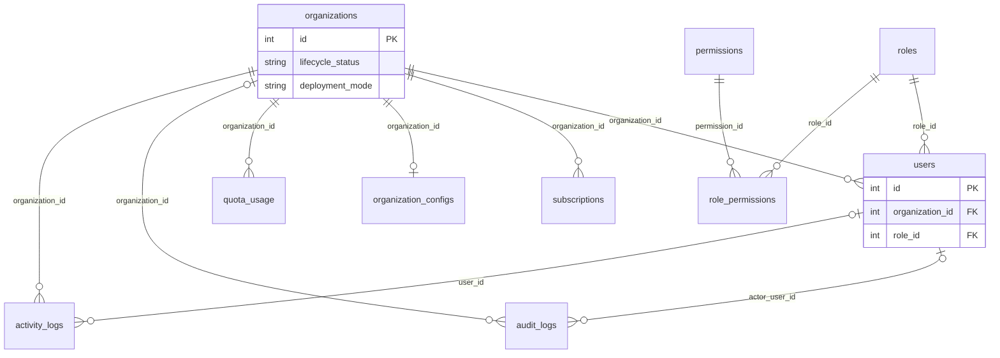
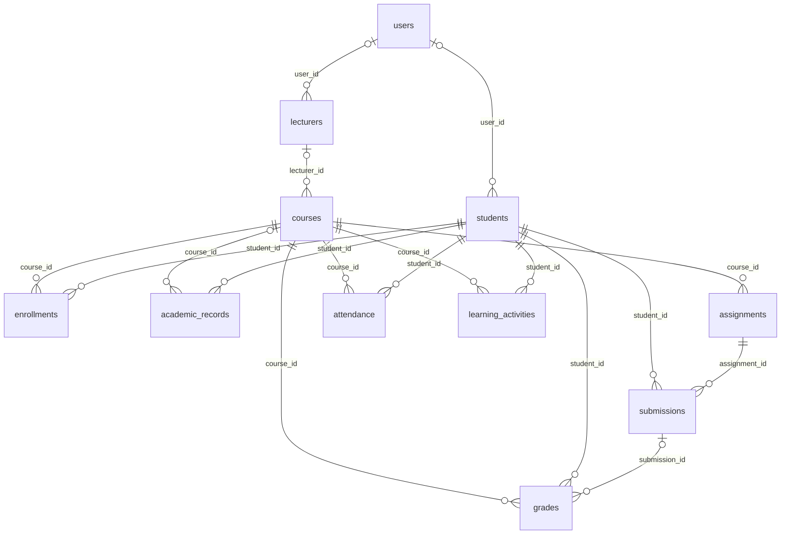
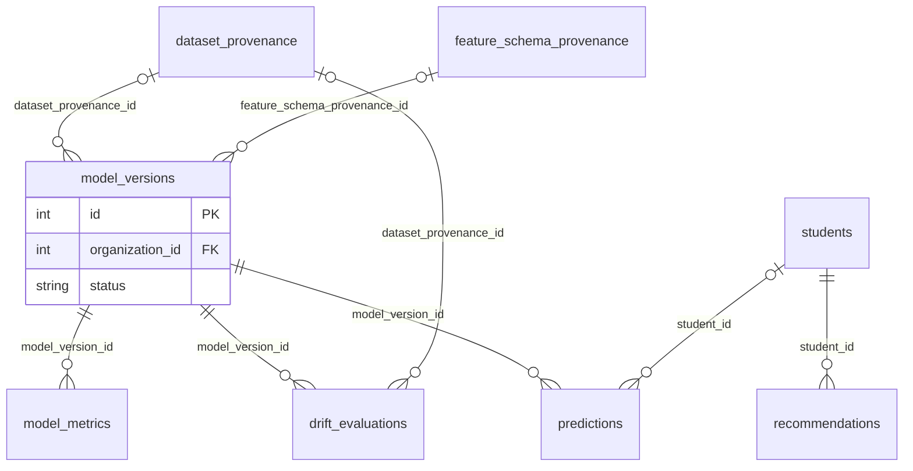
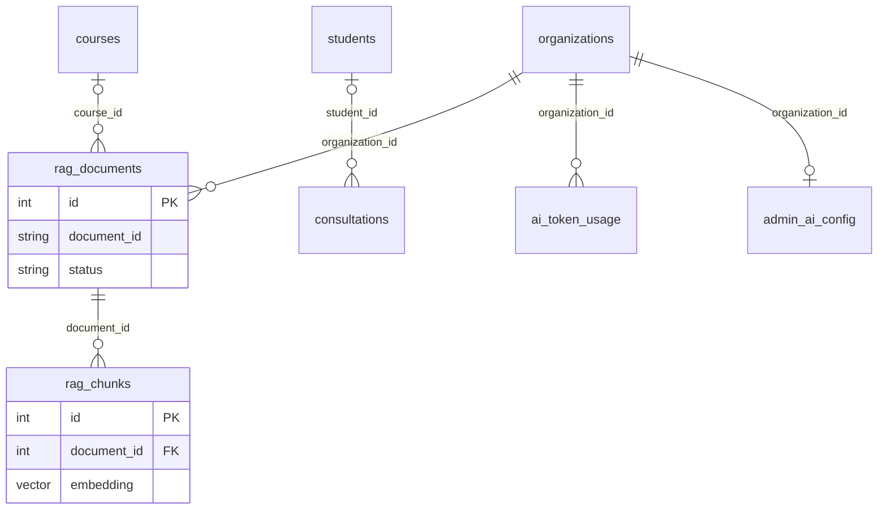
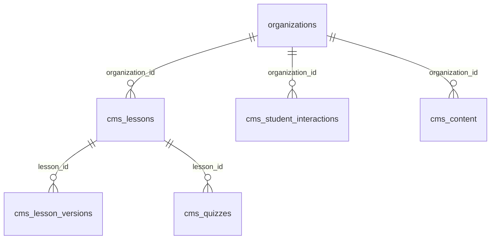
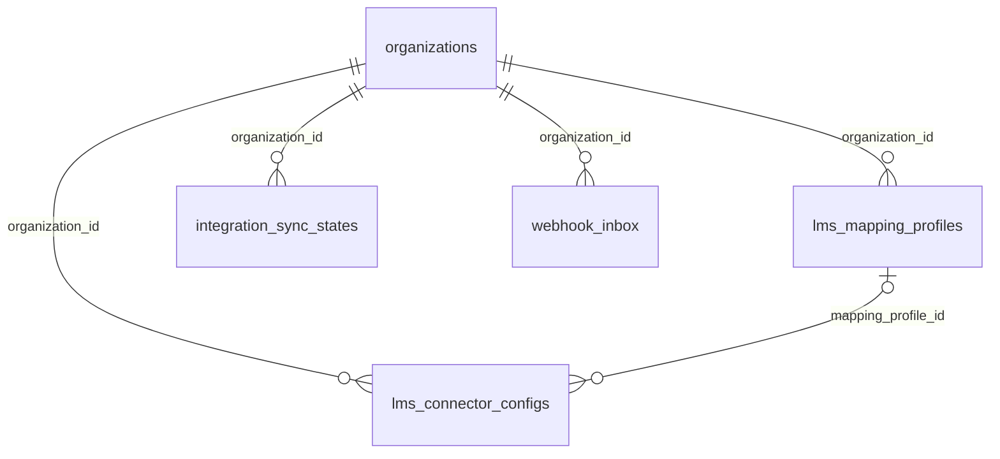
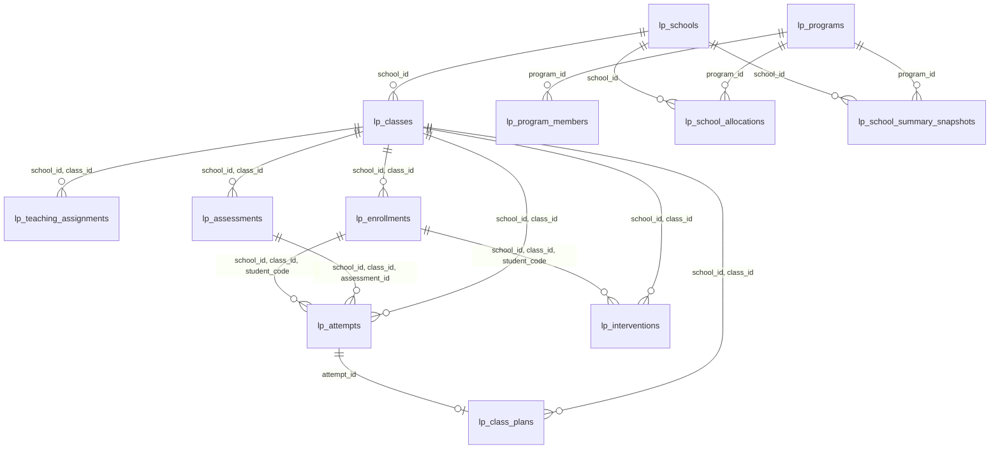

# EduDSS — Cơ sở dữ liệu (schema PostgreSQL)

> **Trạng thái: BẢN NHÁP — chờ chủ dự án duyệt** (soạn 21/11/2026, dựa trên commit 6e9710d)

Tài liệu này liệt kê **mọi bảng** EduDSS tạo trong PostgreSQL, quan hệ giữa chúng, phần chống lộ dữ liệu
giữa các trường (Row Level Security, viết tắt RLS), và chuỗi migration. Mọi con số đều đếm lại từ code.
Mỗi ý đều ghi nguồn. Lý do nào do người soạn tự suy ra thì ghi **(suy luận — cần xác nhận)**.

Tài liệu liên quan: [../architecture/ARCHITECTURE.md](../architecture/ARCHITECTURE.md) ·
[../requirements/PRD.md](../requirements/PRD.md) ·
[../operations/BACKUP_RECOVERY_RUNBOOK.md](../operations/BACKUP_RECOVERY_RUNBOOK.md) ·
[../operations/RELEASE_PROCESS.md](../operations/RELEASE_PROCESS.md)

---

## 1. Tóm tắt bằng lời thường

- Có **54 bảng**, cộng bảng hệ thống `alembic_version` của Alembic:
  - **41 bảng lõi** khai báo trong `dss/db/models.py` (gốc `Base`);
  - **13 bảng nền tảng lớp học** tên bắt đầu bằng `lp_`, khai báo trong `dss/platform/models.py` (gốc `PlatformBase`).
- Cách đếm: đếm dòng `__tablename__` trong hai file (`grep __tablename__` ra 54). Kiểm lại bằng cách nạp
  metadata SQLAlchemy: 41 + 13 bảng; **86 ràng buộc khoá ngoại** (70 ở bảng lõi, 16 ở bảng `lp_*`).
- Có **10 migration** Alembic, nối thành một chuỗi thẳng từ `4915552f6063` tới head `d2e3a6102601`.
- **50/54 bảng** bật RLS (có `FORCE`). 4 bảng danh mục dùng chung không bật: `organizations`, `roles`,
  `permissions`, `role_permissions`.
- Gần như mọi bảng lõi đều có cột `organization_id` trỏ tới `organizations.id`. "Trường" (tenant) chính là
  một dòng trong `organizations` (`dss/db/models.py:13-15,53-54`).
- Alembic **chỉ dùng cho PostgreSQL**. Ở máy dev không bật Postgres, dữ liệu nằm trong file
  (xem [ARCHITECTURE.md](../architecture/ARCHITECTURE.md) mục 5).

## 2. Danh sách bảng theo nhóm

Cột **RLS** ghi cách lọc theo trường:
- **trực tiếp**: lọc bằng `organization_id` của chính bảng;
- **qua bảng cha**: lọc bằng subquery tới bảng cha;
- **lp-policy**: chính sách riêng của bảng `lp_*`, lọc theo `school_id` hoặc chương trình;
- **—**: không bật RLS.

Migration bật RLS ghi trong ngoặc. Nguồn chi tiết ở mục 5.

### 2.1 Tổ chức, phân quyền, người dùng

| Bảng | Mục đích (1 dòng) | Khoá ngoại chính | RLS |
|---|---|---|---|
| `organizations` | Một trường/đơn vị, ranh giới tenant (`dss/db/models.py:53-56`) | — | — |
| `roles` | Danh mục vai trò (`models.py:74-79`) | — | — |
| `permissions` | Danh mục quyền chi tiết (`models.py:88-92`) | — | — |
| `role_permissions` | Bảng nối vai trò ↔ quyền (`models.py:101-107`) | `role_id`→`roles`, `permission_id`→`permissions` | — |
| `users` | Tài khoản đăng nhập, cùng dạng bản ghi với `users.json` (`models.py:110-125`) | `organization_id`→`organizations`, `role_id`→`roles` | trực tiếp (`cbae9b411ed5`) |
| `subscriptions` | Gói thuê bao của trường, cùng dạng với `subscription.json` (`models.py:139-148`) | `organization_id` | trực tiếp (`cbae9b411ed5`) |
| `organization_configs` | Cấu hình riêng của từng trường, 1 dòng/trường (`models.py:888-892`) | `organization_id` (unique) | trực tiếp (`a14b15c16d17`) |
| `quota_usage` | Đã dùng bao nhiêu hạn mức theo kỳ (`models.py:955-962`) | `organization_id` | trực tiếp (`a14b15c16d17`) |
| `audit_logs` | Nhật ký kiểm toán bảo mật (`models.py:630-645`) | `organization_id` (cho phép rỗng), `actor_user_id`→`users` | trực tiếp (`cbae9b411ed5`) |
| `activity_logs` | Lịch sử hoạt động người dùng thấy được (`models.py:655-664`) | `organization_id`, `user_id`→`users` | trực tiếp (`cbae9b411ed5`) |

### 2.2 Học vụ (sinh viên, môn học, điểm)

| Bảng | Mục đích (1 dòng) | Khoá ngoại chính | RLS |
|---|---|---|---|
| `students` | Hồ sơ sinh viên (`models.py:166-177`) | `organization_id`, `user_id`→`users` | trực tiếp (`cbae9b411ed5`) |
| `lecturers` | Hồ sơ giảng viên (`models.py:185-196`) | `organization_id`, `user_id`→`users` | trực tiếp (`cbae9b411ed5`) |
| `courses` | Môn học/lớp học phần (`models.py:203-217`) | `organization_id`, `lecturer_id`→`lecturers` | trực tiếp (`cbae9b411ed5`) |
| `enrollments` | Sinh viên đăng ký môn (`models.py:221-234`) | `organization_id`, `student_id`→`students`, `course_id`→`courses` | trực tiếp (`cbae9b411ed5`) |
| `academic_records` | Mỗi dòng là một dữ kiện học tập (điểm, chuyên cần…) (`models.py:239-250`) | `organization_id`, `student_id`, `course_id` | trực tiếp (`cbae9b411ed5`) |
| `assignments` | Bài tập của môn (`models.py:259-267`) | `organization_id`, `course_id` | trực tiếp (`a14b15c16d17`) |
| `submissions` | Bài nộp của sinh viên (`models.py:273-282`) | `organization_id`, `assignment_id`, `student_id` | trực tiếp (`a14b15c16d17`) |
| `grades` | Điểm (`models.py:287-299`) | `organization_id`, `submission_id`, `student_id`, `course_id` | trực tiếp (`a14b15c16d17`) |
| `attendance` | Điểm danh (`models.py:303-312`) | `organization_id`, `student_id`, `course_id` | trực tiếp (`a14b15c16d17`) |
| `learning_activities` | Hoạt động học tập lấy từ LMS (`models.py:317-326`) | `organization_id`, `student_id`, `course_id` | trực tiếp (`a14b15c16d17`) |

### 2.3 Học máy và dự đoán

| Bảng | Mục đích (1 dòng) | Khoá ngoại chính | RLS |
|---|---|---|---|
| `model_versions` | Phiên bản mô hình, vòng đời candidate/production/archived (`models.py:335-377`) | `organization_id`, `dataset_provenance_id`, `feature_schema_provenance_id` | trực tiếp (`cbae9b411ed5`) |
| `model_metrics` | Chỉ số đánh giá của một phiên bản mô hình (`models.py:391-396`) | `model_version_id`→`model_versions` | qua bảng cha `model_versions` (`cbae9b411ed5`) |
| `dataset_provenance` | Bằng chứng tái lập bộ dữ liệu huấn luyện (`models.py:404-424`) | `organization_id` | trực tiếp (`6cfe48a652ca`) |
| `feature_schema_provenance` | Dấu vân tay hợp đồng đầu vào của mô hình (`models.py:442-460`) | `organization_id` | trực tiếp (`6cfe48a652ca`) |
| `drift_evaluations` | Lịch sử đánh giá trôi dữ liệu (drift) (`models.py:471-490`) | `organization_id`, `model_version_id`, `dataset_provenance_id` | trực tiếp (`6cfe48a652ca`) |
| `predictions` | Kết quả dự đoán cho sinh viên (`models.py:503-517`) | `organization_id`, `student_id`, `model_version_id` (RESTRICT) | trực tiếp (`cbae9b411ed5`) |
| `recommendations` | Gợi ý / kế hoạch học tập có cấu trúc (`models.py:526-533`; dùng cho `LEARNING_PLANS`, `dss/core/persistence_config.py:66`) | `organization_id`, `student_id` | trực tiếp (`cbae9b411ed5`) |

### 2.4 AI, RAG và tư vấn

| Bảng | Mục đích (1 dòng) | Khoá ngoại chính | RLS |
|---|---|---|---|
| `consultations` | Lịch sử tư vấn AI (`models.py:539-549`) | `organization_id`, `student_id` | trực tiếp (`cbae9b411ed5`) |
| `rag_documents` | Tài liệu tri thức cho RAG, có quy trình duyệt (`models.py:565-598`) | `organization_id`, `course_id`→`courses` | trực tiếp (`cbae9b411ed5`) |
| `rag_chunks` | Đoạn văn bản + vector 384 chiều (`models.py:602-618`) | `document_id`→`rag_documents` | qua bảng cha `rag_documents` (`cbae9b411ed5`) |
| `ai_token_usage` | Sổ ghi số token AI đã dùng, chỉ thêm không sửa; không lưu khoá API (`models.py:775-786`) | `organization_id` | trực tiếp (`797f72d1c666`) |
| `admin_ai_config` | Cấu hình nhà cung cấp/mô hình AI, 1 dòng/trường (`models.py:800-813`) | `organization_id` (unique) | trực tiếp (`797f72d1c666`) |

### 2.5 Nội dung bài giảng (CMS)

| Bảng | Mục đích (1 dòng) | Khoá ngoại chính | RLS |
|---|---|---|---|
| `cms_lessons` | Bài giảng và cờ cho phép AI/quiz (`models.py:682-707`) | `organization_id` | trực tiếp (`830742fd75d4`) |
| `cms_lesson_versions` | Các phiên bản tài liệu đã tải lên của bài giảng (`models.py:709-713`) | `lesson_id`→`cms_lessons` | qua bảng cha `cms_lessons` (`830742fd75d4`) |
| `cms_quizzes` | Bộ câu hỏi chờ giảng viên duyệt (`models.py:723-736`) | `organization_id`, `lesson_id`→`cms_lessons` | trực tiếp (`830742fd75d4`) |
| `cms_student_interactions` | Nhật ký hỏi đáp của sinh viên, chỉ lưu bút danh (`models.py:746-756`) | `organization_id` | trực tiếp (`830742fd75d4`) |
| `cms_content` | Nội dung lấy từ CMS ngoài, có checksum (`models.py:935-940`) | `organization_id` | trực tiếp (`a14b15c16d17`) |

### 2.6 Tích hợp LMS

| Bảng | Mục đích (1 dòng) | Khoá ngoại chính | RLS |
|---|---|---|---|
| `lms_mapping_profiles` | Bản ghi kiểm chứng ánh xạ dữ liệu LMS (`models.py:822-833`) | `organization_id` | trực tiếp (`35d62f0c6002`) |
| `lms_connector_configs` | Cấu hình kết nối LMS/CMS của từng trường (`models.py:843-873`) | `organization_id`, `mapping_profile_id`→`lms_mapping_profiles` | trực tiếp (`35d62f0c6002`) |
| `integration_sync_states` | Con trỏ đồng bộ theo nguồn và loại dữ liệu (`models.py:897-904`) | `organization_id` | trực tiếp (`a14b15c16d17`) |
| `webhook_inbox` | Hộp nhận sự kiện webhook, chống nhận trùng (`models.py:914-921`) | `organization_id` | trực tiếp (`a14b15c16d17`) |

### 2.7 Nền tảng lớp học và chương trình (`lp_*`)

Khoá chính các bảng này là chuỗi (UUID hoặc mã trường). Khoá ngoại thường **ghép nhiều cột**
(`school_id` + `class_id` …), để một dòng không thể trỏ sang lớp của trường khác
(`dss/platform/models.py:61-66`). Tất cả bật RLS trong `d2e3a6102601`.

| Bảng | Mục đích (1 dòng) | Khoá ngoại chính | RLS |
|---|---|---|---|
| `lp_schools` | Trường trong nền tảng (`dss/platform/models.py:36-41`) | — | lp-policy: trường mình, operator, quản lý chương trình |
| `lp_classes` | Lớp học theo kỳ (`platform/models.py:44-58`) | `school_id`→`lp_schools` | lp-policy `school_scope` |
| `lp_teaching_assignments` | Giảng viên dạy lớp (`platform/models.py:69-79`) | (`school_id`,`class_id`)→`lp_classes` | lp-policy `school_scope` |
| `lp_enrollments` | Sinh viên trong lớp, theo mã sinh viên (`platform/models.py:82-93`) | (`school_id`,`class_id`)→`lp_classes` | lp-policy `school_scope` |
| `lp_assessments` | Bài đánh giá có phiên bản (`platform/models.py:96-115`) | (`school_id`,`class_id`)→`lp_classes` | lp-policy `school_scope` |
| `lp_attempts` | Lượt làm bài, điểm 0–10 (`platform/models.py:118-149`) | → `lp_classes`, → `lp_assessments`, → `lp_enrollments` (ghép 3 cột) | lp-policy `school_scope` |
| `lp_class_plans` | Kế hoạch học tập sinh ra từ một lượt làm bài (`platform/models.py:152-172`) | → `lp_classes`, → `lp_attempts` (ghép 4 cột) | lp-policy `school_scope` |
| `lp_interventions` | Can thiệp của giảng viên cho sinh viên (`platform/models.py:175-194`) | → `lp_classes`, → `lp_enrollments` | lp-policy `school_scope` |
| `lp_programs` | Chương trình nhiều trường, ngân sách ghế và AI (`platform/models.py:197-209`) | — | lp-policy: operator, thành viên, trường được cấp |
| `lp_program_members` | Thành viên chương trình (manager/analyst) (`platform/models.py:212-224`) | `program_id`→`lp_programs` | lp-policy: chỉ thấy chính mình; operator ghi |
| `lp_school_allocations` | Cấp ghế/ngân sách AI cho một trường (`platform/models.py:227-242`) | `program_id`→`lp_programs`, `school_id`→`lp_schools` | lp-policy: trường mình, operator, thành viên; manager ghi |
| `lp_school_summary_snapshots` | Ảnh chụp số liệu tổng hợp, ẩn khi nhóm dưới 5 người (`platform/models.py:245-258`) | `program_id`→`lp_programs`, `school_id`→`lp_schools` | lp-policy: Admin trường mình, thành viên chương trình |
| `lp_audit_events` | Nhật ký kiểm toán của nền tảng (`platform/models.py:261-270`) | — (cột `school_id`, `program_id` không có khoá ngoại) | lp-policy: theo trường, chương trình hoặc operator |

## 3. Sơ đồ quan hệ (ER)

Vẽ từ các định nghĩa `ForeignKey(...)` / `ForeignKeyConstraint(...)` trong `dss/db/models.py` và
`dss/platform/models.py`. Chỉ ghi vài cột chính. Ở nhóm 3.2–3.6, mũi tên từ `organizations` được lược bớt
cho dễ đọc. Thực tế gần như mọi bảng đều có `organization_id`.

### 3.1 Tổ chức và phân quyền



### 3.2 Học vụ



### 3.3 Học máy và dự đoán



### 3.4 AI, RAG và tư vấn



### 3.5 CMS



### 3.6 Tích hợp LMS



### 3.7 Nền tảng lớp học `lp_*`



Ghi chú:
- `lp_audit_events` không có khoá ngoại nên không có trong sơ đồ.
- Bảng `lp_*` **không** có khoá ngoại sang `organizations` hay `users`. Liên kết bằng giá trị:
  - `school_id` được so với `current_setting('app.organization_id')`
    (`dss/db/migrations/versions/d2e3a6102601_classroom_program_platform.py:241,287`);
  - giảng viên và sinh viên được nhận ra bằng `teacher_username` và `student_code` dạng chuỗi.

## 4. RLS hoạt động thế nào

- Trong mỗi giao dịch, app đặt `SET LOCAL app.organization_id = …`. Policy chỉ trả về những dòng có
  `organization_id` bằng giá trị đó (`cbae9b411ed5_…py:69-77`, ví dụ dùng ở `dss/services/vector_store.py:374`).
  Quên đặt giá trị thì nhận **0 dòng**, không phải dữ liệu trường khác (`cbae9b411ed5_…py:13-15`).
- `FORCE ROW LEVEL SECURITY` để cả chủ bảng cũng bị lọc. Superuser thì luôn bỏ qua RLS. Vì vậy app phải
  kết nối bằng role thường (`cbae9b411ed5_…py:17-23`). Production tách role: `DB_OWNER_USER` chạy migration,
  `DB_APP_USER` chạy app (`deploy/production/docker-compose.prod.yml:47-54,68`, `postgres-init/01-app-role.sh`).
- Bảng `lp_*` dùng thêm `app.principal_school_id`, `app.actor_username`, `app.actor_role` và
  `app.platform_operator` (`d2e3a6102601_…py:241-247`).

## 5. Bảng RLS (đếm lại)

**Cách đếm:** đọc 10 file trong `dss/db/migrations/versions/`. Lấy mọi bảng có
`ALTER TABLE … ENABLE ROW LEVEL SECURITY` trong hàm `upgrade()`. Đối chiếu với 54 tên `__tablename__`.

| Migration | Bảng bật RLS + FORCE | Số bảng | Nguồn |
|---|---|---|---|
| `cbae9b411ed5` | Trực tiếp: `users`, `subscriptions`, `students`, `lecturers`, `courses`, `enrollments`, `academic_records`, `model_versions`, `predictions`, `recommendations`, `consultations`, `rag_documents`, `audit_logs`, `activity_logs`. Qua bảng cha: `model_metrics`, `rag_chunks` | 14 + 2 = 16 | `cbae9b411ed5_…py:39-63,66-91` |
| `830742fd75d4` | Trực tiếp: `cms_lessons`, `cms_student_interactions`, `cms_quizzes`. Qua bảng cha: `cms_lesson_versions` | 3 + 1 = 4 | `830742fd75d4_…py:114-135` |
| `797f72d1c666` | `ai_token_usage`, `admin_ai_config` | 2 | `797f72d1c666_…py:63-72` |
| `a14b15c16d17` | `assignments`, `submissions`, `grades`, `attendance`, `learning_activities`, `organization_configs`, `integration_sync_states`, `webhook_inbox`, `cms_content`, `quota_usage` | 10 | `a14b15c16d17_…py:15-26,184-192` |
| `6cfe48a652ca` | `dataset_provenance`, `feature_schema_provenance`, `drift_evaluations` | 3 | `6cfe48a652ca_…py:28,113-121` |
| `35d62f0c6002` | `lms_connector_configs`, `lms_mapping_profiles` | 2 | `35d62f0c6002_…py:23,92-100` |
| `d2e3a6102601` | 13 bảng `lp_*` (policy riêng theo trường / chương trình) | 13 | `d2e3a6102601_…py:224-238,263-343` |
| **Tổng** | | **50 / 54** | |

- Lọc **trực tiếp** theo `organization_id`: 34 bảng.
- Lọc **qua bảng cha**: 3 bảng.
- **Policy riêng `lp_*`**: 13 bảng.

**Không bật RLS (4 bảng):** `organizations`, `roles`, `permissions`, `role_permissions`. Đây là danh mục
dùng chung, không có `organization_id` (`dss/db/models.py:53-107`). Không thấy migration nào ghi lý do bỏ qua
4 bảng này. Có thể vì chúng không chứa dữ liệu riêng của trường nào (suy luận — cần xác nhận).

> ⚠️ **Cần xác nhận:** `audit_logs.organization_id` cho phép rỗng (`dss/db/models.py:643`), nhưng policy so
> sánh bằng `=`. Vì vậy dòng nhật ký không gắn trường nào sẽ **không đọc được** qua role app
> (suy luận từ `cbae9b411ed5_…py:74-76` — cần xác nhận có phải chủ ý).

## 6. Chuỗi migration

Thứ tự lấy từ `down_revision` trong từng file (`dss/db/migrations/versions/`). Chuỗi thẳng, chỉ có một head.
Code tự kiểm điều này (`dss/db/schema_contract.py:40-44`).

| # | Revision | Cha (`down_revision`) | Mục đích (1 dòng) |
|---|---|---|---|
| 1 | `4915552f6063` initial_schema | — | Bật extension `vector`, tạo 20 bảng gốc (tổ chức, phân quyền, học vụ, ML, RAG, nhật ký) (`4915552f6063_…py:26`) |
| 2 | `cbae9b411ed5` row_level_security_tenant_isolation | `4915552f6063` | Bật RLS + FORCE cho 16 bảng |
| 3 | `830742fd75d4` cms_lessons_quizzes_interactions | `cbae9b411ed5` | Tạo 4 bảng `cms_*` và RLS |
| 4 | `f0b43f540e41` consultation_local_import_dedup_key | `830742fd75d4` | Thêm cột `consultations.local_consultation_id`, chống nhập trùng khi chuyển từ file (`f0b43f540e41_…py:21-29`) |
| 5 | `797f72d1c666` ai_token_usage_and_admin_ai_config | `f0b43f540e41` | Tạo `ai_token_usage`, `admin_ai_config` và RLS |
| 6 | `a14b15c16d17` domain_persistence_closure | `797f72d1c666` | Thêm `external_id` cho 4 bảng học vụ, tạo 10 bảng (bài tập, điểm, webhook, hạn mức…) và RLS (`a14b15c16d17_…py:39-43`) |
| 7 | `6cfe48a652ca` ml_provenance_and_drift | `a14b15c16d17` | Tạo 3 bảng nguồn gốc/drift, thêm 7 cột vào `model_versions`, RLS |
| 8 | `35d62f0c6002` university_onboarding | `6cfe48a652ca` | Thêm `lifecycle_status`, `deployment_mode` cho `organizations`; tạo 2 bảng LMS và RLS (`35d62f0c6002_…py:38-56`) |
| 9 | `9f3a1c7d2e46` rag_document_approval_workflow | `35d62f0c6002` | Thêm 9 cột phê duyệt vào `rag_documents` (mặc định `PENDING_REVIEW`) |
| 10 | `d2e3a6102601` classroom_program_platform (**head**) | `9f3a1c7d2e46` | Tạo 13 bảng `lp_*` với RLS bắt buộc; thêm `rag_documents.course_code` (`d2e3a6102601_…py:1,263-270`) |

Đếm bảng tạo mới: 20 + 4 + 2 + 10 + 3 + 2 + 13 = **54**. Khớp với số `__tablename__`.

## 7. Nâng cấp và quay lui schema

**Alembic chỉ chạy trên PostgreSQL:**
- `alembic.ini` trỏ `script_location` tới `dss/db/migrations` (`alembic.ini`, mục `[alembic]`);
- `env.py` lấy URL từ `dss/db/session.py::_resolve_database_url` (`dss/db/migrations/env.py:15,29`), tức
  `DATABASE_URL` hoặc bộ `DB_HOST/DB_PORT/DB_NAME/DB_USER/DB_PASSWORD` (`dss/db/session.py:4-6`);
- migration đầu tiên chạy `CREATE EXTENSION vector` (`4915552f6063_…py:26`).

Bảng `lp_*` ở chế độ file thì **không** qua Alembic: tạo thẳng bằng `create_all` trên SQLite
(`dss/platform/store.py:38-56`).

**Lệnh nâng cấp** (chạy từ thư mục gốc repo, với role **chủ** CSDL):

```bash
python -m ops.migration_check precheck   # từ chối nếu CSDL ở revision lạ hoặc mới hơn code
python -m alembic upgrade head
python -m ops.migration_check verify     # đúng head, đủ bảng, không có bảng lạ
```

Nguồn:
- `README.md:100-103`;
- service `migrate` trong `deploy/production/docker-compose.prod.yml:52`;
- ý nghĩa từng bước: `docs/operations/RELEASE_PROCESS.md:133-139`.

Lệnh `python -m ops.migration_check status` xem CSDL đang ở revision nào (`docs/operations/RELEASE_PROCESS.md:133`).

**Quay lui:**
- Về mặt kỹ thuật có `python -m alembic downgrade -1`, vì mọi migration đều có `downgrade()`.
- Nhưng mọi migration, trừ migration RLS, đều xoá bảng hoặc cột khi quay lui, nên **mất dữ liệu**.
- Vì vậy quy trình phát hành quy định: production quay lui bằng **khôi phục bản sao lưu trước khi deploy**
  hoặc **sửa tiến (forward fix)**, **không bao giờ** dùng `alembic downgrade`
  (`docs/operations/RELEASE_PROCESS.md:142-145`).
- Thử head → base → head chỉ được làm trên CSDL dùng một lần:
  `python -m ops.migration_check roundtrip --confirm-disposable-database`. Lệnh này bị từ chối trong production
  (`ops/migration_check.py:111-121`, `docs/operations/RELEASE_PROCESS.md:141`).

**Sao lưu và khôi phục:**
- Runbook: [`docs/operations/BACKUP_RECOVERY_RUNBOOK.md`](../operations/BACKUP_RECOVERY_RUNBOOK.md);
- báo cáo diễn tập: [`reports/production_readiness/PHASE13_BACKUP_RECOVERY.md`](../../reports/production_readiness/PHASE13_BACKUP_RECOVERY.md);
- công cụ: `ops/backup_recovery.py`, `deploy/production/remote_backup.sh`.

Runbook **chỉ** bao gồm PostgreSQL, không gồm file mô hình, dataset, file tải lên hay các kho JSON
(`docs/operations/BACKUP_RECOVERY_RUNBOOK.md:3-6`). Xem cảnh báo ở
[ARCHITECTURE.md](../architecture/ARCHITECTURE.md) mục 5.2.

## 8. Mâu thuẫn số liệu

| Nguồn | Nói gì | Thực tế (commit 6e9710d) |
|---|---|---|
| `reports/production_readiness/PHASE1_REPORT.md:28,110-112` | 20 bảng | 20 bảng chỉ đúng với migration đầu `4915552f6063` |
| `reports/production_readiness/PHASE1C_PERSISTENCE_COMPLETION.md:225-226,322`; `reports/production_readiness/FINAL_PHASE1C_ACCEPTANCE.md:26,40` | 27 bảng, 5 migration (tới `797f72d1c666`) | Đúng tại thời điểm Phase 1C; nay đã có thêm 5 migration |
| `reports/final_acceptance/COMMERCIAL_RELEASE_READINESS.md:63` | 9 revision, RLS FORCE trên 34 bảng, 70 FK; đề xuất thêm RLS cho `rag_chunks`, `model_metrics` | 10 revision. RLS trên 50 bảng; riêng nhóm lọc trực tiếp theo `organization_id` đúng là 34. 70 FK chỉ đúng cho 41 bảng lõi; tổng là 86. `rag_chunks` và `model_metrics` **đã có** RLS từ `cbae9b411ed5` |
| `docs/operations/BACKUP_RECOVERY_RUNBOOK.md:8-9` | Alembic `797f72d1c666`, 27 bảng | Head `d2e3a6102601`, 54 bảng |
| `docs/operations/RELEASE_PROCESS.md:17` | Ví dụ `alembic_head` = `9f3a1c7d2e46` | Head thật `d2e3a6102601` (chưa sửa file đó trong đợt này) |
| **Thực tế** | | **54 bảng** (41 + 13 `lp_*`) + `alembic_version`; **10 migration**; **50 bảng có RLS**; **86 FK** |
