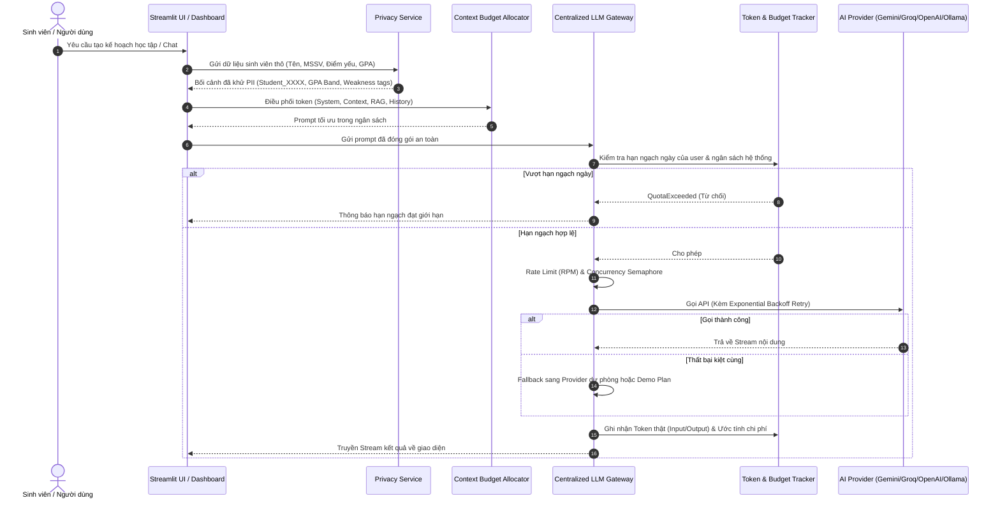
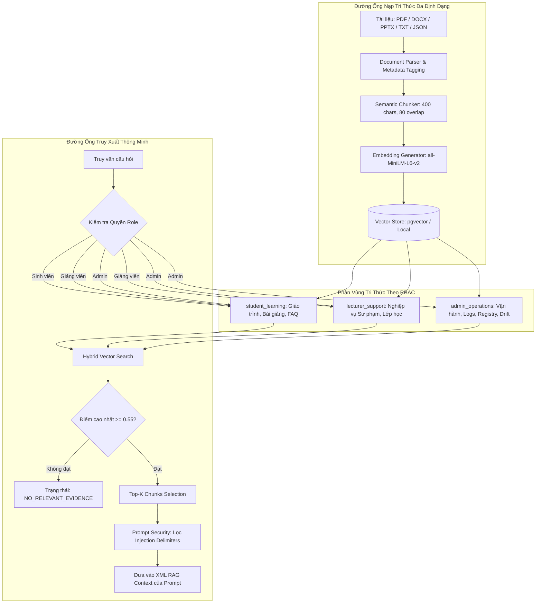

# Walkthrough: Tái Cấu Trúc Toàn Diện Kiến Trúc AI/RAG/LLM Cho Quy Mô LMS (~20.000 Sinh Viên/Năm)

Tài liệu nghiệm thu và báo cáo kỹ thuật chi tiết sau khi hoàn thành tái cấu trúc hệ thống AI, RAG và LLM trong EduDSS nhằm phục vụ quy mô thực tế cấp trường đại học (~20.000 sinh viên/năm), đảm bảo bảo mật dữ liệu, kiểm soát ngân sách token, phòng vệ prompt injection và phân tách tri thức đa tầng.

---

## 1. Tóm Tắt Kết Quả Kiểm Thử (Verification Results)

- **Kiểm thử bộ mới LMS AI/RAG/Gateway**: `tests/test_lms_ai_rag_gateway.py` (17/17 tests PASS 100% trong 5.59s)
- **Kiểm thử bộ Audit & Governance trước đó**: `tests/test_audit_and_governance.py` (15/15 tests PASS 100%)
- **Kiểm thử hồi quy toàn hệ thống**: 161/161 tests PASS 100% (0 failures, 0 regressions).

---

## 2. Danh Sách Các Tệp Đã Tạo & Sửa Đổi

| Trạng thái | Tệp | Trách nhiệm thực thi |
|---|---|---|
| **MỚI** | [`dss/services/llm_gateway.py`](file:///d:/KLTN/code/app/dss/services/llm_gateway.py) | Centralized LLM Gateway (routing, API key resolution, exponential retry backoff, sliding-window rate limiting, concurrency semaphore, fallback cascade, error normalization). |
| **MỚI** | [`dss/services/token_tracker.py`](file:///d:/KLTN/code/app/dss/services/token_tracker.py) | Token & Cost Tracking (input/output/total tokens, định mức giá model, hạn ngạch ngày theo role, cảnh báo 80%/100% ngân sách hệ thống, atomic json log, bảo mật không log API key). |
| **MỚI** | [`dss/services/prompt_security.py`](file:///d:/KLTN/code/app/dss/services/prompt_security.py) | Phòng vệ Indirect Prompt Injection, làm sạch văn bản không tin cậy, cô lập ranh giới XML `<system_instructions>`, `<student_context>`, `<untrusted_retrieved_evidence>`, `<user_query>`. |
| **MỚI** | [`dss/services/privacy_service.py`](file:///d:/KLTN/code/app/dss/services/privacy_service.py) | Bảo vệ quyền riêng tư sinh viên: Khử PII, tạo mã định danh giả danh `Student_XXXX`, che giấu email/SĐT/MSSV, ghi log danh mục dữ liệu thay vì PII thô. |
| **MỚI** | [`dss/services/context_budget.py`](file:///d:/KLTN/code/app/dss/services/context_budget.py) | Quản lý ngân sách ngữ cảnh token: System prompt (500), Student context (300), RAG context (1500), Chat history (800), Output reserve (1000). Cắt tỉa lịch sử và chunks thông minh. |
| **MỚI** | [`dss/services/citation_service.py`](file:///d:/KLTN/code/app/dss/services/citation_service.py) | Định dạng nhãn trích dẫn có cấu trúc và bộ xác thực `verify_citations` phát hiện tài liệu ảo giác (hallucinated sources). |
| **MỚI** | [`dss/services/rag_namespaces.py`](file:///d:/KLTN/code/app/dss/services/rag_namespaces.py) | Phân tách 3 không gian tri thức (`student_learning`, `lecturer_support`, `admin_operations`) theo RBAC. Ngăn chặn tuyệt đối việc lưu hồ sơ sinh viên thành tài liệu tri thức. |
| **MỚI** | [`dss/services/chunking_service.py`](file:///d:/KLTN/code/app/dss/services/chunking_service.py) | Semantic Chunking Pipeline: Phân đoạn đệ quy theo đoạn/câu với kích thước 400 ký tự, độ chồng lặp 80 ký tự, tính toán token và tạo metadata `DocumentChunk`. |
| **MỚI** | [`dss/services/document_ingestion.py`](file:///d:/KLTN/code/app/dss/services/document_ingestion.py) | Nạp tài liệu sản xuất đa định dạng (PDF, DOCX, PPTX, TXT/Markdown, LMS JSON) kèm metadata chuẩn hóa (`document_id`, `course_id`, `semester`, `version`, `permission_scope`...). |
| **MỚI** | [`dss/services/vector_store.py`](file:///d:/KLTN/code/app/dss/services/vector_store.py) | Kiến trúc Vector Store kép: PostgreSQL + pgvector (DDL schema HNSW index cho sản xuất LMS) và LocalVectorStore phân vùng theo namespace cho dev/demo. |
| **MỚI** | [`dss/services/rag_evaluator.py`](file:///d:/KLTN/code/app/dss/services/rag_evaluator.py) | Đánh giá định lượng RAG: Recall@K, Precision@K, MRR, nDCG@K, Latency kèm tập 8 truy vấn benchmark chuẩn có gán nhãn ground-truth. |
| **MỚI** | [`dss/services/llm_evaluator.py`](file:///d:/KLTN/code/app/dss/services/llm_evaluator.py) | Đánh giá chất lượng LLM: Groundedness, Faithfulness, Answer Relevance, Citation Correctness, bộ lọc lời khuyên độc hại / gian lận, schema đánh giá giảng viên. |
| **MỚI** | [`dss/services/admin_agent.py`](file:///d:/KLTN/code/app/dss/services/admin_agent.py) | Admin AI Agent hoạt động trong namespace `admin_operations`: giám sát metrics/logs/drift, tự động chạy bảo trì rủi ro thấp, kiểm soát nghiêm ngặt tác vụ rủi ro cao. |
| **MỚI** | [`tests/test_lms_ai_rag_gateway.py`](file:///d:/KLTN/code/app/tests/test_lms_ai_rag_gateway.py) | Bộ kiểm thử toàn diện gồm 17 bài test kiểm chứng chi tiết từng yêu cầu kiến trúc. |
| **SỬA** | [`dss/core/models.py`](file:///d:/KLTN/code/app/dss/core/models.py) | Đính chính comment dòng 290 từ "8 tài liệu" thành "19 tài liệu" (doc_001 đến doc_019 - Demo Knowledge). |
| **SỬA** | [`dss/services/rag_service.py`](file:///d:/KLTN/code/app/dss/services/rag_service.py) | Nâng cấp đường ống `retrieve_context` với hỗ trợ namespace và trạng thái `NO_RELEVANT_EVIDENCE` (không ép buộc trả về tài liệu lạc đề). |
| **SỬA** | [`dss/services/llm_service.py`](file:///d:/KLTN/code/app/dss/services/llm_service.py) | Tích hợp theo dõi token/chi phí trong Compare AI và cung cấp `get_gateway()`. |
| **SỬA** | [`dss/tabs/knowledge_base.py`](file:///d:/KLTN/code/app/dss/tabs/knowledge_base.py) | Cung cấp giao diện xem tài liệu theo Namespace và bộ nạp tài liệu thật (PDF, DOCX, PPTX, TXT, JSON). |
| **SỬA** | [`dss/tabs/admin_reports.py`](file:///d:/KLTN/code/app/dss/tabs/admin_reports.py) | Bổ sung dashboard giám sát Token Usage & Cost (LLM Gateway Telemetry) cho Admin. |
| **SỬA** | [`dss/config.py`](file:///d:/KLTN/code/app/dss/config.py) | Bổ sung hằng số cấu hình Chunk Size (400), Chunk Overlap (80), RAG Strict No Evidence. |

---

## 3. Sơ Đồ Luồng Kiến Trúc

### 3.1. Luồng Xử Lý Yêu Cầu LLM (Centralized LLM Gateway)



### 3.2. Luồng Xử Lý RAG (Multi-Namespace Ingestion & Retrieval)



---

## 4. Đặc Tả Dữ Liệu & Schemas

### 4.1. Token Usage & Cost Schema (`data_warehouse/ai_token_usage.json`)
```json
{
  "usage_id": "use_a1b2c3d4e5f6",
  "timestamp": "2026-09-11T14:15:30Z",
  "user_id": "user_student_7A3B",
  "role": "Sinh viên",
  "request_type": "advisor_plan",
  "provider": "gemini-1.5-flash",
  "model": "gemini-1.5-flash",
  "input_tokens": 1250,
  "output_tokens": 680,
  "total_tokens": 1930,
  "estimated_cost": 0.000298
}
```

### 4.2. PostgreSQL + pgvector Schema (Chuẩn Sản Xuất LMS)
```sql
CREATE EXTENSION IF NOT EXISTS vector;

CREATE TABLE IF NOT EXISTS rag_documents (
    document_id VARCHAR(64) PRIMARY KEY,
    course_id VARCHAR(64) NOT NULL,
    semester VARCHAR(32) NOT NULL,
    title TEXT NOT NULL,
    source TEXT,
    version VARCHAR(16) DEFAULT '1.0',
    permission_scope VARCHAR(32) NOT NULL DEFAULT 'student_learning',
    uploaded_by VARCHAR(64) DEFAULT 'admin',
    created_at TIMESTAMP WITH TIME ZONE DEFAULT NOW(),
    updated_at TIMESTAMP WITH TIME ZONE DEFAULT NOW()
);

CREATE TABLE IF NOT EXISTS rag_chunks (
    chunk_id VARCHAR(128) PRIMARY KEY,
    document_id VARCHAR(64) REFERENCES rag_documents(document_id) ON DELETE CASCADE,
    course_id VARCHAR(64) NOT NULL,
    permission_scope VARCHAR(32) NOT NULL DEFAULT 'student_learning',
    content TEXT NOT NULL,
    token_count INT DEFAULT 0,
    metadata JSONB DEFAULT '{}'::jsonb,
    embedding vector(384) NOT NULL
);

CREATE INDEX IF NOT EXISTS idx_chunks_embedding_hnsw 
ON rag_chunks USING hnsw (embedding vector_cosine_ops)
WITH (m = 16, ef_construction = 64);

CREATE INDEX IF NOT EXISTS idx_chunks_scope_course 
ON rag_chunks (permission_scope, course_id);
```
