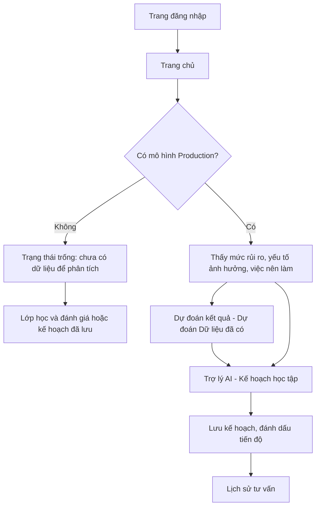
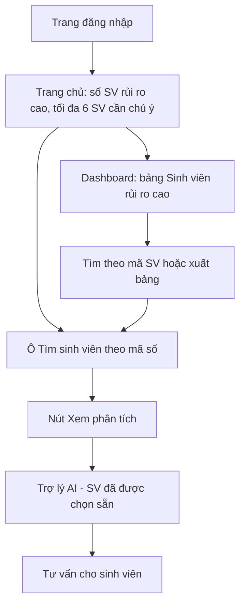
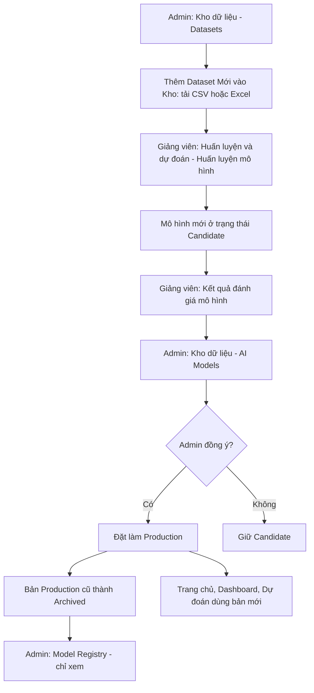
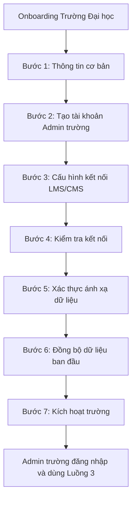

# EduDSS — Bản đồ màn hình (Screen map)

> **Trạng thái: BẢN NHÁP — đã cập nhật theo quyết định của chủ dự án ngày 21/11/2026** (soạn dựa trên commit 6e9710d)

Tài liệu này cho biết mỗi vai trò thấy những trang nào, người dùng đi qua các trang theo thứ tự nào,
và mockup nào khớp với trang nào trong code. Mọi tên trang lấy đúng từ code. Không có màn hình nào mới
được thêm vào.

Tài liệu liên quan: [../requirements/PRD.md](../requirements/PRD.md) ·
[../requirements/MVP_SCOPE.md](../requirements/MVP_SCOPE.md) ·
[../requirements/ACCEPTANCE_CRITERIA.md](../requirements/ACCEPTANCE_CRITERIA.md) ·
[../architecture/ARCHITECTURE.md](../architecture/ARCHITECTURE.md) · [../database/SCHEMA.md](../database/SCHEMA.md)

---

## 1. Khung ứng dụng

- **Trước khi đăng nhập:** màn hình chờ khi khởi động (`dss/tabs/loading_screen.py:61`), màn lỗi khởi động
  có mã lỗi (`dss/tabs/loading_screen.py:102`), rồi trang đăng nhập (`dss/services/auth_service.py:917`).
  Nút Google chỉ hiện khi đã cấu hình (`dss/services/google_signin.py:1-11`).
- **Sau khi đăng nhập:** thanh bên trái có logo, menu theo vai trò, hồ sơ, chọn giao diện và đăng xuất
  (`dss/main.py:202-219`). Menu chia nhóm theo `SIDEBAR_NAV_GROUPS` (`dss/main.py:225-253`). Trang nào
  có quyền mà không thuộc nhóm nào sẽ nằm trong nhóm "KHÁC" (`dss/main.py:295-299`).
- **Thanh trên cùng:** chỉ Admin và Giảng viên có ô "Tìm sinh viên theo mã số" (`dss/main.py:370-379`,
  `dss/services/search_service.py:30`).
- Tên trong code (ví dụ `🧪 Huấn luyện — Dự đoán`) khác tên hiển thị. Tên hiển thị lấy từ
  `TAB_SHORT_LABELS` (`dss/core/roles.py:16-36`) và `ROLE_TAB_LABELS` (`dss/core/roles.py:42-51`).

## 2. Trang theo vai trò

Danh sách 20 trang: `ALL_TABS` (`dss/core/roles.py:151-172`). Quyền: `TAB_ACCESS` (`dss/core/roles.py:175-237`).

### 2.1 Sinh viên (`dss/main.py:226-232`)

| Nhóm menu | Tên hiển thị | Trang con | Code |
|---|---|---|---|
| (đầu) | Trang chủ | — | `dss/tabs/home.py:218` |
| HỌC TẬP & PHÂN TÍCH | Lớp học và đánh giá | Bài đánh giá, kết quả, kế hoạch theo lớp | `dss/tabs/classroom_tab.py:376-385` |
| HỌC TẬP & PHÂN TÍCH | Dự đoán kết quả | Dự đoán — Nhập tay · Dự đoán — Dữ liệu đã có | `dss/main.py:773-777` |
| HỌC TẬP & PHÂN TÍCH | Nhóm học tập & gợi ý | — | `dss/tabs/clustering.py:18` |
| TRỢ LÝ AI | Trợ lý AI | Kế hoạch học tập · Hướng nghiệp · Giải thích bài học | `dss/main.py:821-835` |
| TRỢ LÝ AI | Lịch sử tư vấn | — | `dss/tabs/consultation_history.py:14` |

Trong "Hướng nghiệp" có 7 thẻ (`dss/tabs/advisory.py:1111-1121`). Thẻ này bị chặn ở chế độ production
(`dss/tabs/advisory.py:1037-1039`).

### 2.2 Giảng viên / CVHT (`dss/main.py:233-240`)

| Nhóm menu | Tên hiển thị | Trang con | Code |
|---|---|---|---|
| TỔNG QUAN | Trang chủ | — | `dss/tabs/home.py:69` |
| TỔNG QUAN | Dashboard | Phân tích Điểm số · Phân tích Xếp loại · Thêm thông tin | `dss/tabs/dashboard.py:324`, `:630` |
| PHÂN TÍCH LỚP HỌC | Lớp học và đánh giá | Tiến độ lớp, soạn bài, theo dõi hỗ trợ | `dss/tabs/classroom_tab.py:386-387` |
| PHÂN TÍCH LỚP HỌC | Khám phá dữ liệu | Tương quan · Importance; Giải thích / Tạo features | `dss/tabs/eda.py:233`, `:855`, `:1182` |
| PHÂN TÍCH LỚP HỌC | Huấn luyện & dự đoán | Kết quả đánh giá mô hình · Huấn luyện mô hình · Dự đoán (Nhập tay · Dữ liệu đã có · Hàng loạt) | `dss/main.py:558-560`, `:779-785` |
| PHÂN TÍCH LỚP HỌC | Phân cụm & gợi ý | — | `dss/tabs/clustering.py:18` |
| HỖ TRỢ & TÀI LIỆU | Chương trình và cấp phát | — | `dss/tabs/programs_tab.py:184` |
| HỖ TRỢ & TÀI LIỆU | Trợ lý AI | Tư vấn AI · Tư vấn Định hướng · Giải thích Bài giảng (CMS) | `dss/main.py:821-825` |
| HỖ TRỢ & TÀI LIỆU | Duyệt tài liệu | — | `dss/tabs/knowledge_base.py:422` |
| HỖ TRỢ & TÀI LIỆU | Kho dữ liệu | Datasets · AI Models · History | `dss/tabs/warehouse_tab.py:26-28` |

"Kết quả đánh giá mô hình" có 4 thẻ: Phân loại, Hồi quy, Phân cụm, Giải thích (SHAP)
(`dss/tabs/evaluation_report.py:414`).

### 2.3 Admin (`dss/main.py:241-252`)

| Nhóm menu | Tên hiển thị | Trang con | Code |
|---|---|---|---|
| (đầu) | Tổng quan | (dùng lại trang Báo cáo) | `dss/tabs/home.py:46-59` |
| NGƯỜI DÙNG & DỮ LIỆU | Lớp học và đánh giá | Tạo lớp, nhập danh sách lớp CSV | `dss/tabs/classroom_tab.py:351-360` |
| NGƯỜI DÙNG & DỮ LIỆU | Người dùng | — | `dss/tabs/admin_settings.py:31` |
| NGƯỜI DÙNG & DỮ LIỆU | Kho dữ liệu | Datasets · AI Models (Promote/Rollback) · History | `dss/tabs/warehouse_tab.py:26-28`, `:616-622` |
| NGƯỜI DÙNG & DỮ LIỆU | Khám phá dữ liệu | như Giảng viên | `dss/tabs/eda.py:233` |
| TRI THỨC & AI | Học liệu của trường | Nạp & Quản lý · Duyệt Quiz · Dashboard phân tích | `dss/main.py:434-435`, `dss/tabs/learning_explainer_tab.py:410` |
| TRI THỨC & AI | Tài liệu & quy chế (RAG) | Tài liệu môn học · Nguồn tham khảo & Demo · Không gian tri thức · Tải lên | `dss/tabs/knowledge_base.py:110-115` |
| TRI THỨC & AI | Cấu hình AI | — | `dss/tabs/ai_advisor.py:1823` |
| TRI THỨC & AI | Trợ lý AI | như Giảng viên | `dss/main.py:821-825` |
| VẬN HÀNH | Chương trình và cấp phát | Công bố số liệu tổng hợp | `dss/tabs/programs_tab.py:190-191` |
| VẬN HÀNH | Tích hợp LMS/CMS | — | `dss/tabs/admin_settings.py:171` |
| VẬN HÀNH | Mô hình ML (Model Registry) | Chỉ xem | `dss/tabs/warehouse_tab.py:669-676` |
| VẬN HÀNH | Báo cáo & giám sát | — | `dss/tabs/admin_reports.py:84-89` |
| VẬN HÀNH | Cài đặt | Điều chỉnh thuê bao | `dss/tabs/admin_settings.py:280`, `:312` |

### 2.4 Platform Admin

Không có nhóm menu riêng trong `SIDEBAR_NAV_GROUPS`, nên các trang hiện trong nhóm "ĐIỀU HƯỚNG"
(`dss/main.py:268`). Vai trò này thấy **2 trang**: "Chương trình và cấp phát" (`dss/core/roles.py:178`) và
"Onboarding Trường Đại học" (`dss/core/roles.py:236`). Chú thích ở `dss/core/roles.py:231-235` ghi là
"exactly this one tab". Chú thích này đã cũ so với dòng 178.

| Tên hiển thị | Trang con | Code |
|---|---|---|
| Chương trình và cấp phát | Đăng ký trường · Tạo chương trình · Phân quyền · Cấp phát | `dss/tabs/programs_tab.py:30-81`, `:188-189` |
| Onboarding Trường Đại học | 7 bước (xem luồng 4) · Vô hiệu hoá / Kích hoạt lại | `dss/tabs/university_onboarding_tab.py:21`, `:65-167` |

## 3. Luồng người dùng chính

### Luồng 1 — Sinh viên xem rủi ro và nhận lời khuyên

Nguồn: `dss/tabs/home.py:218-240`, `dss/main.py:411-419`, `dss/main.py:852-853`,
`reports/stage1_learning/ACCEPTANCE.md:27-28`.

### Luồng 2 — Giảng viên/CVHT tìm sinh viên có nguy cơ trong lớp

Nguồn: `dss/tabs/home.py:108-167`, `dss/tabs/dashboard.py:536-560`, `dss/main.py:370-407`.
Mức rủi ro là **xếp hạng tương đối** (25% thấp nhất lớp), không phải xác suất (`dss/tabs/ui_kit.py:462`).

### Luồng 3 — Nhập dữ liệu, huấn luyện và đưa mô hình lên Production

Admin **không** có trang huấn luyện (`dss/core/roles.py:186`), và Giảng viên **không** được đổi bản
Production (`dss/tabs/warehouse_tab.py:616-619`). Vì vậy luồng này cần **2 vai trò**.

Nguồn: `dss/tabs/warehouse_tab.py:196-198`, `dss/main.py:558-560`, `dss/core/warehouse.py:458`,
`dss/tabs/warehouse_tab.py:621-622`, `dss/tabs/warehouse_tab.py:669-676`.

### Luồng 4 — Platform Admin nhận một trường mới

Nguồn: `dss/tabs/university_onboarding_tab.py:65-151`. Luồng này "Để sau" theo đề xuất ở
[MVP_SCOPE.md](../requirements/MVP_SCOPE.md) §5.

## 4. So sánh mockup với code

Có **2 bộ mockup**, cùng tên tệp nhưng nội dung khác nhau:

- `ui_reference/`: chữ **không dấu** (ví dụ tiêu đề "Ket qua hoc tap"), biểu tượng menu là chữ cái. Có thêm
  `lecturer_home.html` và `lecturer_dashboard.html` ở thư mục gốc.
- `EduDSS_UI_Reference_Kit/EduDSS_UI_Reference/`: chữ **có dấu** ("Kết quả học tập"), biểu tượng là ký hiệu.
- Cả 2 đều có cùng `README.md` ghi đây là "visual source-of-truth" (`ui_reference/README.md:11`).
- Báo cáo bảo mật xếp cả 2 bộ là mockup thiết kế có số "Độ chính xác mô hình 0.875" giả, đã loại khỏi image
  (`reports/final_acceptance/C1_1_SECURITY_PRIVACY_HARDENING.md:121`).

| Mockup (cả 2 bộ trừ khi ghi khác) | Trang trong code | Mức khớp |
|---|---|---|
| `login.html` | Trang đăng nhập (`dss/services/auth_service.py:917`) | Khớp |
| `student/dashboard.html` (Trang chính) | Trang chủ SV | Khớp |
| `student/analytics.html` (Kết quả học tập) | Có thể là Trang chủ hoặc Nhóm học tập & gợi ý | **Suy đoán**: không có trang nào cùng tên |
| `student/prediction.html` (Dự đoán cá nhân) | Dự đoán kết quả | Khớp |
| `student/learning_plan.html` (Lộ trình học tập) | Trợ lý AI → Kế hoạch học tập | Khớp |
| `student/ai_assistant.html` (Tư vấn AI) | Trợ lý AI | Khớp |
| `student/resources.html` (Tài liệu học tập) | Có thể là Trợ lý AI → Giải thích bài học, hoặc học liệu trong Lớp học | **Suy đoán**: không có trang nào cùng tên |
| `student/history.html` | Lịch sử tư vấn | Khớp |
| — | Lớp học và đánh giá (SV) | **Không có mockup** |
| `lecturer_home.html` (chỉ `ui_reference/`) | Trang chủ GV | Khớp |
| `lecturer/dashboard.html`, `lecturer_dashboard.html` | Dashboard | Khớp |
| `lecturer/students_data.html` (Sinh viên & dữ liệu) | Có thể là Kho dữ liệu hoặc Khám phá dữ liệu | **Suy đoán** |
| `lecturer/risk_analysis.html` (Phân tích rủi ro) | Phân tích rủi ro (`dss/tabs/lecturer_pages.py`, thêm 21/11/2026) | Khớp |
| `lecturer/training.html` | Huấn luyện mô hình | Khớp |
| `lecturer/prediction.html` | Thẻ Dự đoán | Khớp |
| `lecturer/clustering.html` | Phân cụm & gợi ý | Khớp |
| `lecturer/ai_advisor.html` | Trợ lý AI | Khớp |
| `lecturer/reports.html` (Báo cáo) | Báo cáo (`dss/tabs/lecturer_pages.py`, thêm 21/11/2026). Số liệu thật, không dùng số trong mockup | Khớp |
| `lecturer/history.html` (Lịch sử tư vấn) | Lịch sử tư vấn của giảng viên (`dss/tabs/lecturer_pages.py`, thêm 21/11/2026) | Khớp |
| — | Lớp học, Chương trình, Duyệt tài liệu (GV) | **Không có mockup** |
| `admin/dashboard.html` (Tổng quan hệ thống) | Tổng quan | Khớp |
| `admin/data_management.html` | Kho dữ liệu | Khớp |
| `admin/user_management.html` | Người dùng | Khớp |
| `admin/model_management.html` | Kho dữ liệu → AI Models | Khớp |
| `admin/model_registry.html` | Model Registry | Khớp |
| `admin/knowledge_base.html` | Tài liệu & quy chế (RAG) | Khớp |
| `admin/reports.html` | Báo cáo & giám sát | Khớp |
| `admin/ai_config.html` | Cấu hình AI | Khớp |
| `admin/settings.html` | Cài đặt | Khớp |
| — | Tích hợp LMS/CMS, Lớp học, Chương trình, Học liệu của trường (Admin) | **Không có mockup** |
| — | Mọi trang của Platform Admin | **Không có mockup** |

> ✅ **ĐÃ CHỐT (21/11/2026): làm thêm 3 trang giảng viên theo mockup** (`reports`, `history`, `risk_analysis`).
> - Mẫu dùng: `ui_reference/lecturer/reports.html`, `history.html`, `risk_analysis.html`. Bộ
>   `EduDSS_UI_Reference_Kit/` cũng có các file cùng tên; nếu hai bộ khác nhau thì lấy `ui_reference/`,
>   vì `ui_reference/README.md` tự ghi là "visual source-of-truth". *(Suy ra từ quyết định, chủ dự án xác
>   nhận lại nếu muốn khác.)*
> - Với các trang **đã có**, giao diện trong code là chuẩn. Trang nào chưa có mockup thì không cần vẽ thêm.
> - Trước khi lập trình (bước 6) cần đặc tả nội dung từng trang và phân biệt với các trang gần giống:
>   Dashboard "Sinh viên rủi ro cao", Kho dữ liệu — History, Lịch sử tư vấn.
> - Tiêu chí nghiệm thu: AC-GV-09, AC-GV-10, AC-GV-11 ([ACCEPTANCE_CRITERIA.md](../requirements/ACCEPTANCE_CRITERIA.md)).

## 5. Thiết kế dùng chung

### 5.1 Token màu, chữ, khoảng cách

Mọi token nằm ở `dss/styles/main.css:18-80`. Trang không được dùng mã màu riêng (`dss/styles/main.css:4`).

| Nhóm | Giá trị (chế độ sáng) | Nguồn |
|---|---|---|
| Màu chính | `--primary #2F5BD3`, `--primary-hover #1F3F9E` | `dss/styles/main.css:37-38` |
| Trạng thái | `--success #17A673`, `--warning #F3B21C`, `--danger #D94B3F`, `--info #1967D2` | `dss/styles/main.css:42-49` |
| Phông chữ | `Be Vietnam Pro`, tự lưu trong app | `dss/styles/main.css:61`, `.streamlit/config.toml:27-51` |
| Cỡ chữ | thân 15px, tiêu đề trang 32px, chú thích 13px | `dss/styles/main.css:62-73` |
| Bo góc / chiều cao nút | 6 / 8 / 12px; ô điều khiển 40px | `dss/styles/main.css:54-56`, `:76` |
| Khoảng cách | 4 / 8 / 12 / 16 / 24 / 32 px | `dss/styles/main.css:15` |
| Thanh bên | rộng 288px | `dss/styles/main.css:78` |
| Chế độ tối | đổi bộ token (ví dụ `--primary #8AA8FF`) | `dss/styles/main.css:113`, `:125` |
| Theo hệ điều hành | `prefers-color-scheme: dark` | `dss/styles/main.css:144-145` |

Lưu ý: báo cáo độ tương phản kiểm token cũ `--ed-primary: #2563EB`
(`reports/final_ui_functional_audit/RESPONSIVE_ACCESSIBILITY_REPORT.md:41`), không phải `--primary #2F5BD3`
hiện tại. Độ tương phản của màu hiện tại **chưa có bằng chứng**.

### 5.2 Trạng thái giao diện

| Trạng thái | Hàm | Khi nào dùng |
|---|---|---|
| Trống | `empty_state` (`dss/tabs/ui_kit.py:282`) | Thật sự chưa có dữ liệu |
| Lỗi | `error_state` (`dss/tabs/ui_kit.py:293`) | Lỗi thân thiện, không hiện traceback |
| Báo lỗi kèm ghi log | `report_error` (`dss/tabs/ui_kit.py:305`) | Ẩn chi tiết kỹ thuật, ghi vào nhật ký |
| Dịch vụ tạm ngưng | `unavailable_state` (`dss/tabs/ui_kit.py:315`) | Hết thời gian chờ, nhà cung cấp AI lỗi |
| Đang tải | `loading_state` (`dss/tabs/ui_kit.py:340`) | Khu vực đang chờ dữ liệu |
| Khởi động lần đầu | `cold_start_aware_message` (`dss/tabs/ui_kit.py:324`) | Báo "có thể mất khoảng 1 phút" khi nạp mô hình embedding |
| Màn chờ / màn lỗi khởi động | `render_loading_screen`, `render_error_screen` (`dss/tabs/loading_screen.py:61`, `:102`) | Trước khi vào app |
| Chưa có dữ liệu cho trang | `_render_no_data_state` (ví dụ `dss/main.py:470`) | Trang cần dataset mà chưa có |

## 6. Phạm vi responsive

| Độ rộng | Quy tắc CSS | Bằng chứng kiểm thử |
|---|---|---|
| 1920 / 1440 / 1366 px | `@media (max-width: 1366px)` (`dss/styles/main.css:1634`) | Đạt (`reports/final_ui_functional_audit/RESPONSIVE_ACCESSIBILITY_REPORT.md:3-13`) |
| 1024 px | `@media (max-width: 1024px)` (`dss/styles/main.css:1216`, `:1637`) | Đạt (`reports/final_acceptance/C1_3_UI_UX_ACCEPTANCE.md:106-107`) |
| 900 px (trang đăng nhập xếp 1 cột) | `dss/styles/main.css:1569` | Có ghi trong `reports/final_acceptance/C1_3_UI_UX_ACCEPTANCE.md:107` |
| 640 px trở xuống (điện thoại) | `dss/styles/main.css` mục 15b: sidebar thu gọn ẩn hẳn, nút menu cố định 40px, thanh điều hướng sinh viên `dss_mobile_nav`, thẻ xuống dòng, ẩn thanh công cụ biểu đồ | Đạt ở 375 và 430 px cho 4 trang sinh viên (`tests/e2e/test_c1_3_ui_journeys_e2e.py::test_student_pages_usable_on_phone`, 21/11/2026). Trang của giảng viên/Admin **không** nằm trong phạm vi điện thoại |

Còn mở về trợ năng: chưa kiểm viền focus, chưa kiểm cấu trúc cho trình đọc màn hình, chưa chạy axe-core
(`reports/final_ui_functional_audit/RESPONSIVE_ACCESSIBILITY_REPORT.md:45-50`).

> ✅ **ĐÃ CHỐT (21/11/2026): máy tính cho mọi vai trò + sinh viên xem được trên điện thoại** (phương án a + b).
> - Trang sinh viên phải dùng được ở khổ 375–430 px: Trang chủ, Dự đoán từ dữ liệu của mình, Kế hoạch học
>   tập, Lịch sử tư vấn. Đã có quy tắc CSS 640/480 px nhưng **chưa có bằng chứng kiểm thử**.
> - Việc cần làm: thêm khổ điện thoại vào `tests/e2e/test_c1_3_ui_journeys_e2e.py:141`, sửa chỗ tràn, kiểm
>   thanh bên Streamlit thu gọn được trên điện thoại. Tiêu chí: AC-SV-09.
> - Không làm ứng dụng mobile riêng.
